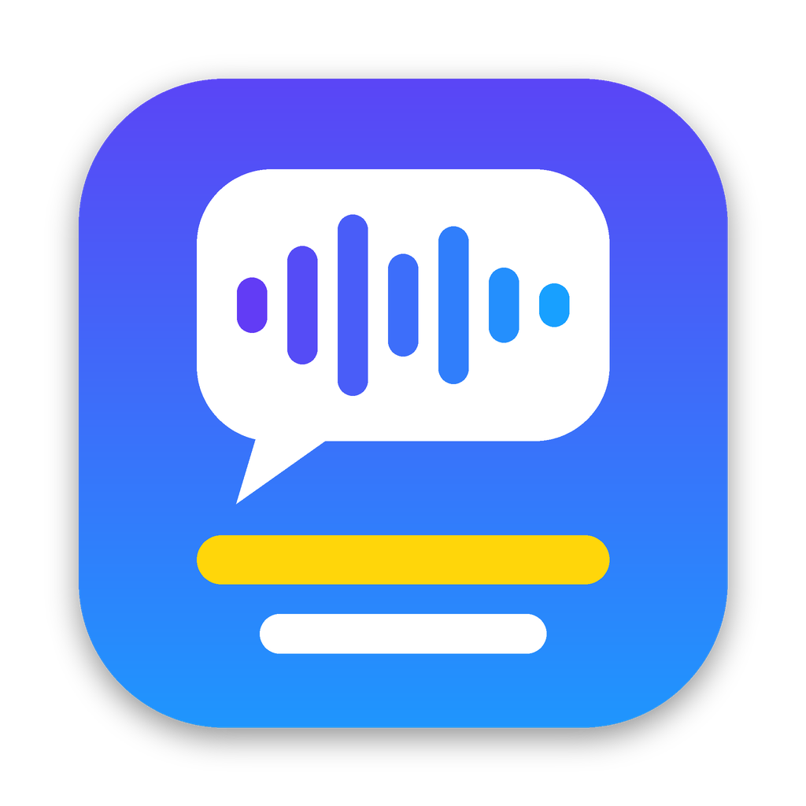

# zimu-ai（字幕AI）



一个 macOS 菜单栏应用：自动识别 Mac 上正在播放的声音，用 AI 实时翻译成你选择的语言，然后在一个**可调透明度的悬浮窗**里显示，就像影片的外挂字幕。

- 系统要求：**macOS 26 (Tahoe) 及以上**
- 语音识别：Apple 本地识别（默认，免费、离线；可多语言自动切换）、WhisperKit 本地识别（自动检测语言），或任意 OpenAI 兼容的云端识别服务
- 翻译：Apple 本地翻译（免费、离线），或任意 OpenAI 兼容服务（OpenAI / DeepSeek / 通义千问 / Kimi / 智谱 / Ollama 等）；可以同时翻译成最多 3 种语言
- 字幕窗：置顶，可以显示在全屏视频之上；背景透明度、字号、颜色、双语 / 单语都可调；锁定后鼠标点击会穿透到下层窗口

## 安装

1. 在 [Actions](https://github.com/lingchenfs1/zimu-ai/actions) 最新一次成功构建的 **Artifacts** 中下载 `ZimuAI-dmg`，或者在 [Releases](https://github.com/lingchenfs1/zimu-ai/releases) 下载 `ZimuAI-x.y.z.dmg`。
2. 打开 DMG，把 **ZimuAI** 拖到「应用程序」文件夹。
3. 没有用 Developer ID 签名公证的版本，第一次打开时会提示“无法验证开发者”。可以在「应用程序」里**右键点击 ZimuAI → 打开 → 打开**，或者在终端运行：
   ```bash
   xattr -dr com.apple.quarantine /Applications/ZimuAI.app
   ```

## 使用

1. 启动后，菜单栏会出现字幕图标 💬。点击图标打开控制面板。
2. 点 **开始字幕**（或按 `⌃⌥S`）。第一次开始时，系统会请求「录制系统音频」权限，请允许。
   - 如果没有看到电平跳动：打开 **系统设置 › 隐私与安全性 › 屏幕与系统录音**，在「仅系统录音」中允许「字幕AI」，然后重新开始。
3. 播放视频或音频，字幕就会出现在悬浮窗里。
4. 调整字幕窗：
   - 未锁定时，拖动字幕窗可以移动，拖动四条边或四个角可以调整大小。
   - 点字幕窗右上角的「锁定」（或按 `⌃⌥L`）后，字幕窗不再响应鼠标，点击会穿透到下面的播放器。
   - 在控制面板或 设置 › 外观 中调整背景透明度、字号、颜色、显示模式。可以先点「演示字幕」预览效果。
5. 结束后可以点 **导出 SRT…** 保存本次字幕。

### 快捷键

| 快捷键 | 功能 |
|---|---|
| `⌃⌥S` | 开始 / 停止字幕 |
| `⌃⌥L` | 锁定 / 解锁字幕窗 |
| `⌃⌥H` | 显示 / 隐藏字幕窗 |

## 设置说明

打开控制面板 → **设置…**：

- **通用**：音频来源（全部系统音频，或只捕获某个应用）、原声语言、翻译成的语言、登录时自动启动、录制 10 秒系统音频测试。
- **识别**（四种引擎，可随时切换）
  - *Apple 本地识别（单一语言）*：离线识别，延迟最低，需要手动选择原声语言。第一次使用某种语言时会自动下载模型，也可以点「检查 / 下载语言模型」提前下载。「识别模式」默认「准确优先」（错字更少，每句晚一点定稿），也可以选「速度优先」。
  - *Apple 本地识别（多语言自动切换）*：勾选 2～4 种可能出现的语言，本地同时识别，按识别置信度自动切换到正在说的语言，控制面板会显示「当前：xx」。
  - *WhisperKit 本地识别（自动检测语言）*：用开源 Whisper 模型在本机识别，自动判断近百种语言。第一次需要下载模型（Base 约 145 MB）；国内网络可以点「使用 hf-mirror.com」改用镜像下载。模型保存在 `~/Library/Application Support/ZimuAI/WhisperKit`。
  - *专有名词与纠错*（对所有识别引擎生效）：「专有名词」填人名、品牌、术语，AI 翻译和 AI 校对会按这些写法处理；「纠错替换」一行一条 `识别结果 → 正确写法`（例如 `克劳德 → Claude`），识别出的文字会先替换再断句和翻译。Apple 本地识别不支持自定义词汇，经常听错的词用纠错替换最有效。
  - *OpenAI 兼容云端识别*：填写服务地址（例如 `https://api.openai.com/v1`）、API Key 和模型（例如 `gpt-4o-mini-transcribe`、`whisper-1`，Groq 可用 `whisper-large-v3-turbo`）。原声语言选「自动检测」时每段音频自动判断语言。
- **翻译**
  - *同时翻译成*：主目标语言之外，可以再勾选最多 2 种语言。每句字幕分别翻译成这些语言，依次显示在主译文下方，导出的 SRT 也包含全部译文。
  - *实时翻译识别中的文字*：一句话还没说完就开始翻译，译文与原文基本同步（默认开启；使用云端翻译时会增加调用次数）。
  - *Apple 本地翻译*：离线翻译，需要先点「下载语言包」下载对应的语言。多语言识别时每种候选语言、同时翻译成多种语言时每种目标语言都需要对应的语言包。
  - *OpenAI 兼容服务*：可以从预设里选择常见服务，再填 API Key。本机 Ollama 地址为 `http://localhost:11434/v1`、LM Studio 为 `http://localhost:1234/v1`，不需要 Key。
    - 内置已经调好的字幕翻译提示词（只输出译文、原文可能有识别错误、问句只翻译不回答、按目标语言的标点和口语风格），可以选「翻译场景」（影视剧对白、课程讲座、新闻访谈、游戏直播），也可以写「额外要求」（比如“人名保留英文”）；展开「查看发送给模型的提示词」能看到实际内容。
    - 「自动关闭模型思考」默认开启：Ollama / LM Studio 附加 `reasoning_effort: none`，通义千问 / 硅基流动附加 `enable_thinking: false`，智谱 / 豆包附加 `thinking: disabled`，Qwen3 在提示词末尾加 `/no_think`；服务不支持时自动去掉重试。模型输出的思考过程无论如何都会被过滤，不会显示在字幕上。
    - 「用 AI 校对识别文字」：翻译主目标语言时让模型顺便改正识别错的字，字幕和 SRT 显示校正后的原文；不增加请求次数，改动过大时保留原识别结果。
    - 还可以设置参考前文句数、同时翻译几句、温度和额外请求参数（JSON，同名字段优先于自动参数）。
- **外观**：显示模式（双语 / 仅译文 / 仅原文）、字号、颜色、背景和文字透明度、圆角、同时显示几条字幕、多久后自动隐藏。

API Key 只保存在 macOS 钥匙串中。

## 常见问题

- **第一次开始字幕时没反应？** 第一次会弹出「录制系统音频」授权对话框，请点「允许」。控制面板会显示等待授权的提示；如果没有看到弹窗，到 系统设置 › 隐私与安全性 › 屏幕与系统录音 中允许「字幕AI」，然后重新开始。
- **没有电平 / 没有字幕？** 在 设置 › 通用 点「录制 10 秒系统音频测试」，确认能录到声音。
- **译文慢？** 确认已开启「实时翻译识别中的文字」；云端翻译可以提高「同时翻译」句数，并保持「自动关闭模型思考」开启。推理模型（deepseek-r1、qwq 等）无法关闭思考，建议换成 qwen2.5、qwen3、deepseek-chat 等非推理模型。
- **字幕里出现了模型的思考过程？** 升级到 v1.3.0 以上：思考过程会被自动过滤。如果模型只返回思考过程、没有译文，会提示“模型只返回了思考过程”，请换用非推理模型。
- **识别不准？** Apple 本地识别使用「准确优先」模式；经常听错的人名、术语加到「纠错替换」；使用 OpenAI 兼容翻译时可以开启「用 AI 校对识别文字」。单语言识别不会判断语言，视频里经常混说其他语言时可以开启 AI 校对，或改用多语言识别。
- **漏句？** 如果是字幕滚动太快来不及看，可以在 设置 › 外观 调大「同时显示几条」和「自动隐藏」时间。

## 从源码构建

需要 macOS 26 和 Xcode 26。

```bash
brew install xcodegen
xcodegen generate                         # 生成 ZimuAI.xcodeproj
open ZimuAI.xcodeproj                     # 在 Xcode 中运行
swift test --package-path Packages/ZimuCore   # 运行核心逻辑单元测试
scripts/package_dmg.sh                    # Release 构建后打包 DMG（输出到 dist/）
```

### 发布与签名

- 每次推送到 PR / main，GitHub Actions 会在 macOS 26 上测试、构建，并把 DMG 作为构建产物上传。
- 推送 `v*` 标签（例如 `git tag v1.0.0 && git push origin v1.0.0`）会自动创建 GitHub Release 并附上 DMG；也可以在 Actions 页面手动运行 **Build** 工作流并填写 `release_tag`（例如 `v1.0.1`），由 CI 在当前提交上创建标签和 Release。
- 如果在仓库 Secrets 中配置了 `MACOS_CERTIFICATE`（Developer ID 证书 .p12 的 base64）、`MACOS_CERTIFICATE_PASSWORD`、`DEVELOPER_ID_APPLICATION`，CI 会用 Developer ID 签名；再配置 `NOTARY_APPLE_ID`、`NOTARY_PASSWORD`（App 专用密码）、`NOTARY_TEAM_ID` 会自动公证。未配置时使用本地签名。

## 项目结构

```
App/                    macOS 应用（SwiftUI + AppKit）
  Audio/                Core Audio Process Tap 系统音频捕获、格式转换、录音
  Speech/               识别引擎：Apple SpeechAnalyzer、OpenAI 兼容云端识别
  Translation/          Apple 本地翻译
  Pipeline/             捕获 → 识别 → 断句 → 翻译 → 字幕 的流水线
  Overlay/              悬浮字幕窗
  Settings/ MenuBar/    设置窗口、菜单栏面板
Packages/ZimuCore/      与平台无关的核心逻辑 + 单元测试（断句、OpenAI 兼容客户端、VAD、SRT 等）
docs/DEVELOPMENT_PLAN.md  开发计划与进度
```
